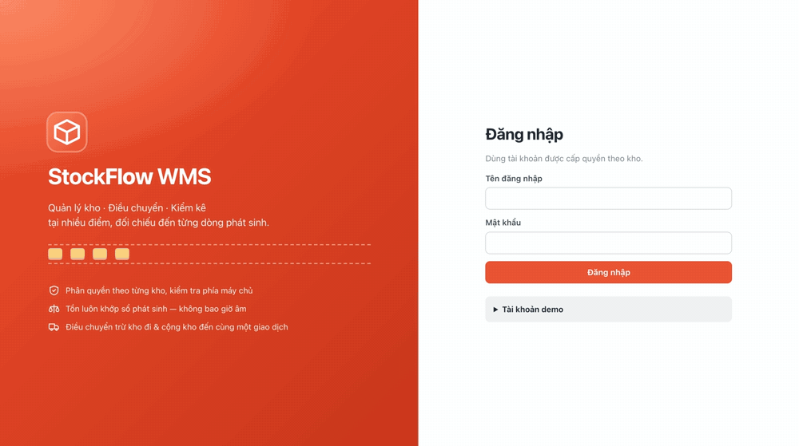
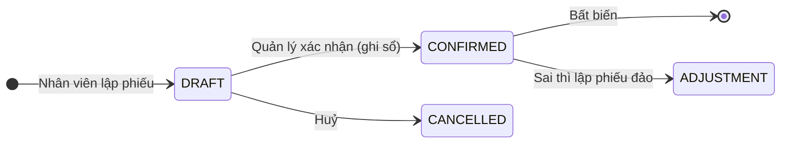
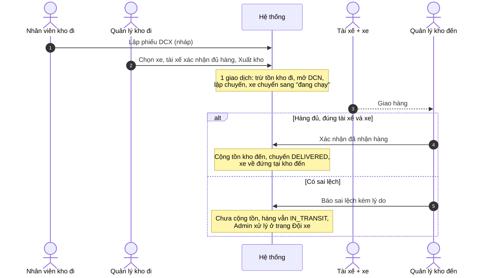
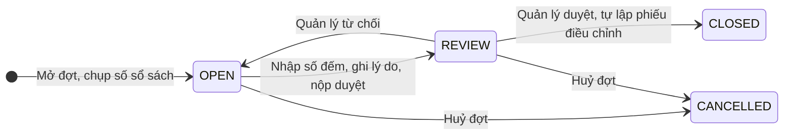
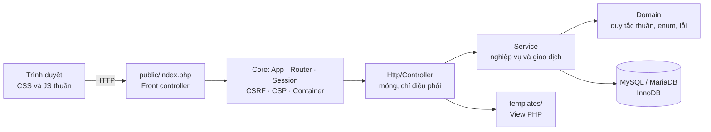
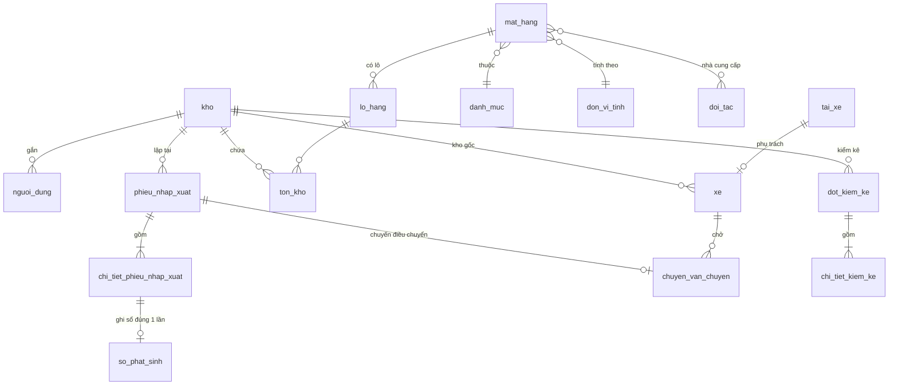

<div align="center">


<a href="https://github.com/buivanchuong9/PTPMMNM-CNTT-1811-NHOM-2"></a>

[](https://www.php.net/)
[](#-cài-đặt-và-chạy)
[](#-cấu-trúc-mã-nguồn)
[](#-kiểm-thử)
[](LICENSE)

**[Tính năng](#-tính-năng) · [Cài đặt và chạy](#-cài-đặt-và-chạy) · [Vai trò](#-vai-trò-và-phân-quyền) · [Quy trình](#-quy-trình-nghiệp-vụ) · [Kiến trúc](#-kiến-trúc) · [Kiểm thử](#-kiểm-thử)**

</div>


## 📖 Giới thiệu

**Chương Đại Dương** (tên mã nội bộ: *StockFlow*) là hệ thống **quản lý kho nhiều điểm** viết bằng **PHP thuần + MySQL**, không dùng framework và không cần Composer. Đề tài môn *Phát triển phần mềm mã nguồn mở*, lớp CNTT 1811, nhóm 2.

Điểm khác biệt nằm ở chỗ **tồn kho luôn tin cậy được**:

- Tồn kho được tính từ một **sổ phát sinh bất biến** (chỉ thêm, không sửa, không xoá).
- Sai thì **lập phiếu đảo** chứ không sửa lịch sử.
- Điều chuyển giữa hai kho chạy **trong một giao dịch**: hoặc xong cả hai đầu, hoặc không đổi gì.
- Hai người cùng xuất một món hàng cuối cùng thì **chỉ một người thành công**.

<div align="center"></div>


## ✨ Tính năng

| | Chức năng | Mô tả |
|:-:|---|---|
| 🏬 | **Nhiều kho, quyền theo kho** | Mỗi kho có 1 quản lý và nhiều nhân viên. Tài khoản chỉ thấy và thao tác trong kho của mình. |
| 📥📤 | **Phiếu nhập / xuất** | Quy trình *nháp → xác nhận → ghi sổ*. Gửi lại cùng một yêu cầu không sinh phiếu thứ hai (khoá chống trùng). Phiếu xuất báo **thiếu hàng** trước khi ghi sổ. Xuất cho khách mới thì có bước nhập thông tin khách. |
| 🚚 | **Điều chuyển liên kho kèm xe** | Kho đi chọn xe và tài xế xác nhận nhận đủ hàng. Sinh cặp phiếu **DCX** (đi) và **DCN** (đến). Kho đến kiểm hàng đủ, đúng tài xế và đúng xe rồi mới nhận. Có sai lệch thì **báo sai lệch** và hàng vẫn ở trạng thái đang vận chuyển. |
| 📋 | **Kiểm kê** | Mở đợt, đếm thực tế, ghi lý do chênh lệch, nộp duyệt. Quản lý duyệt thì hệ thống tự lập **phiếu điều chỉnh**. Trạng thái: `OPEN → REVIEW → CLOSED`. |
| ↩️ | **Sửa sai = đảo phiếu** | Phiếu đã ghi sổ không sửa được. Hệ thống lập phiếu điều chỉnh ngược (mỗi phiếu chỉ đảo được một lần). Điều chuyển thì đảo cả hai đầu cùng lúc. |
| 📖 | **Sổ phát sinh & đối chiếu** | Tra cứu lịch sử theo kho, mặt hàng, lô, thời gian. Trang **Đối chiếu** so số dư hiện hành với tổng sổ và báo `KHỚP` hoặc `LỆCH`. |
| 📦 | **Hàng hoá** | Danh mục loại hàng, đơn vị tính, mặt hàng, **quy cách lô** (một thùng gồm bao nhiêu đơn vị), lô và **hạn dùng**, định mức tồn tối thiểu, nhà cung cấp của từng mặt hàng. |
| 🤝 | **Đối tác** | Nhà cung cấp và khách hàng. Gắn mặt hàng với nhà cung cấp, có thể ngừng hoạt động thay vì xoá. |
| 🚛 | **Đội xe & tài xế** | Xe có biển số, loại xe, kho gốc, tài xế phụ trách. Theo dõi xe đang đứng ở kho nào hoặc đang chạy tới đâu. Danh sách chuyến gần đây và các chuyến còn sai lệch chưa xử lý. |
| 📊 | **Tổng quan & báo cáo** | Thẻ thống kê, biểu đồ nhập xuất 14 ngày, luồng theo kho 30 ngày, cảnh báo **sắp hết hàng**, phiếu chờ xác nhận. Xuất **CSV**: tồn kho, sổ phát sinh, đối chiếu. |
| 🔐 | **Phân quyền động** | Admin bật hoặc tắt từng chức năng cho vai trò Quản lý hoặc Nhân viên. Chức năng bị thu hồi sẽ ẩn khỏi menu và bị chặn ở máy chủ, nhưng không bị xoá. |
| ⚙️ | **Cài đặt** | Hồ sơ, đổi mật khẩu, ảnh đại diện, giao diện **sáng / tối**, số dòng mỗi trang, chế độ gọn. Quản lý kho sửa thông tin kho và nhân viên của mình. Admin đặt độ dài mật khẩu tối thiểu, thời gian tự đăng xuất khi không thao tác, và xem nhật ký thao tác. |
| 🗺️ | **Địa chỉ Việt Nam** | Chọn tỉnh, huyện, xã theo dữ liệu hành chính có sẵn (`public/assets/data/vn-address.json`). |


## 🚀 Cài đặt và chạy

> **Cả nhóm dùng một database duy nhất: MySQL (XAMPP).** Cần `git`, **PHP ≥ 8.1** (có `pdo_mysql`, XAMPP đã kèm sẵn) và **MySQL ≥ 8.0.16 hoặc MariaDB ≥ 10.4**.

### 1️⃣ Chuẩn bị

- Cài [XAMPP](https://www.apachefriends.org), mở XAMPP Control Panel và bấm **Start** ở **MySQL**.
- Cài `git`. Kiểm tra PHP bằng `php -v`. Nếu chưa có PHP trong PATH thì dùng PHP của XAMPP (`C:\xampp\php`).

### 2️⃣ Lấy mã nguồn

```bash
git clone https://github.com/buivanchuong9/PTPMMNM-CNTT-1811-NHOM-2.git
cd PTPMMNM-CNTT-1811-NHOM-2
```

### 3️⃣ Một lệnh để cập nhật mọi thứ

```bash
php bin/stockflow update
```

Dùng cho **cả máy mới lẫn sau mỗi lần `git pull`**, chạy lại bao nhiêu lần cũng an toàn:

1. **Cấu hình kết nối.** Chưa có thì dùng mặc định của XAMPP (`root`, không mật khẩu, database `stockflow`) và ghi vào `.local/db.json`. File này chỉ nằm trên máy bạn, không bị commit. Mật khẩu khác thì chạy `php bin/stockflow db-config`.
2. **Tạo database** `stockflow` nếu máy chưa có, rồi **so với chuẩn của dự án** (bảng, cột, khoá ngoại, CHECK, trigger; chuẩn lấy thẳng từ `database/migrations`).
   - Đúng chuẩn thì không đụng gì.
   - Thiếu bảng mới thì chỉ thêm bảng, giữ nguyên dữ liệu.
   - Cấu trúc đổi thì **sao lưu toàn bộ dữ liệu** vào `.local/backup-…/`, dựng lại đúng chuẩn, rồi nạp lại dữ liệu cũ.
3. **Database trống** thì nạp dữ liệu mẫu (xem [Dữ liệu mẫu](#-dữ-liệu-mẫu)).
4. **Bật git hook** `.githooks/post-merge`: từ giờ mỗi lần `git pull` mà thư mục `database/` có thay đổi thì database tự được cập nhật.

> ⚠️ Khi `update` hoặc `db-sync` đang chạy, **đừng tắt terminal hay kill tiến trình php**. Nếu bị ngắt giữa lúc nạp lại, dữ liệu vẫn nằm trong `.local/backup-…/` (mỗi bảng một file `.ndjson`).

### 4️⃣ Chạy web

```bash
php bin/stockflow serve        # → http://127.0.0.1:8080   (đổi cổng: PORT=9000 php bin/stockflow serve)
```

`serve` cũng tự kiểm tra database trước khi mở web.

### 5️⃣ Đăng nhập

Mật khẩu chung của mọi tài khoản mẫu: **`demo1234`**

| Tài khoản | Vai trò | Kho |
|---|---|---|
| `admin` | Quản trị hệ thống | Tất cả |
| `hn.quanly` · `hn.nv1` · `hn.nv2` | Quản lý / Nhân viên | `HN01` Kho trung tâm Hà Nội |
| `dn.quanly` · `dn.nv1` · `dn.nv2` | Quản lý / Nhân viên | `DN01` Kho Đà Nẵng |
| `hcm.quanly` · `hcm.nv1` · `hcm.nv2` | Quản lý / Nhân viên | `HCM01` Kho TP. Hồ Chí Minh |

### 🧰 Lệnh `bin/stockflow`

| Lệnh | Tác dụng |
|---|---|
| `update` | Cập nhật sau `git pull` hoặc máy mới: cấu hình MySQL, database đúng chuẩn, dữ liệu mẫu nếu trống, git hook |
| `db-config` | Nhập thông tin MySQL và lưu vào `.local/db.json` |
| `check` | Kiểm tra kết nối và phiên bản MySQL |
| `db-sync [--check]` | Kiểm tra database có đúng chuẩn không và tự sửa (sao lưu, dựng lại, nạp lại). `--check` chỉ báo cáo, không sửa |
| `migrate` | Tạo hoặc cập nhật bảng (chạy lại an toàn) |
| `seed [--force]` | Nạp dữ liệu mẫu. Bỏ qua nếu đã có dữ liệu |
| `setup` | `db-sync` + `seed` (như `update` nhưng không đụng cấu hình và git hook) |
| `serve` | Chạy web tại `http://127.0.0.1:8080` |
| `test` | Chạy toàn bộ kiểm thử trên CSDL `stockflow_test` |

<details><summary><b>🛠 Gặp lỗi?</b></summary>

| Thông báo | Cách xử lý |
|---|---|
| `php: command not found` | Thêm `C:\xampp\php` vào PATH, hoặc gọi `C:\xampp\php\php.exe bin/stockflow update` |
| Không kết nối được MySQL / `Connection refused` | Mở XAMPP, Start **MySQL**, rồi chạy lại `update` |
| `Access denied` | Máy bạn đặt mật khẩu cho `root`: chạy `php bin/stockflow db-config` |
| Cổng 8080 bận | `PORT=9000 php bin/stockflow serve` |

Lỗi kết nối được giải thích kèm cách xử lý (MySQL chưa chạy, sai mật khẩu, chưa có CSDL, thiếu quyền).
</details>

<details><summary><b>🗄 Dùng tài khoản MySQL riêng thay vì root (tuỳ chọn)</b></summary>

```sql
CREATE DATABASE stockflow      CHARACTER SET utf8mb4;
CREATE DATABASE stockflow_test CHARACTER SET utf8mb4;   -- chỉ để chạy test
CREATE USER 'stockflow'@'localhost' IDENTIFIED BY 'DoiMatKhauNay';
GRANT ALL ON stockflow.*      TO 'stockflow'@'localhost';
GRANT ALL ON stockflow_test.* TO 'stockflow'@'localhost';
SET GLOBAL log_bin_trust_function_creators = 1;         -- tuỳ chọn: khoá bất biến bằng trigger
```

```bash
php bin/stockflow db-config    # nhập kết nối → .local/db.json
php bin/stockflow update
php bin/stockflow test         # chạy trên stockflow_test (tự xoá sạch và dựng lại, không đụng dữ liệu thật)
```

Có thể thay `db-config` bằng biến môi trường `DB_HOST`, `DB_PORT`, `DB_NAME`, `DB_USER`, `DB_PASS`.
</details>


## 👥 Vai trò và phân quyền

Một tài khoản cấp cao quản lý nhiều tài khoản con. Tài khoản con được gắn **đúng một kho**, nên khi lập phiếu hệ thống tự lấy kho (và địa chỉ) của tài khoản. Cơ sở dữ liệu cũng chặn các trường hợp sai: `CHECK` không cho Admin gắn kho, và `UNIQUE` không cho một kho có hai quản lý.

| Vai trò | Làm được gì |
|---|---|
| **Quản trị hệ thống** (`ADMIN`) | **Xem thống kê** tồn và xuất nhập của mọi kho. **Quản lý** kho, mặt hàng, danh mục, đối tác, tài khoản, đội xe, phân quyền. *Không* lập phiếu nhập xuất, đó là việc của kho. |
| **Quản lý kho** (`MANAGER`, mỗi kho đúng 1) | Xác nhận, huỷ, điều chỉnh phiếu. Duyệt kiểm kê. Nhận hàng điều chuyển. Đối chiếu, báo cáo. Thêm nhân viên cho kho mình. **Chỉ trong kho mình.** |
| **Nhân viên kho** (`STAFF`, mỗi kho nhiều) | Lập phiếu nhập, xuất, điều chuyển (nháp). Nhận hàng điều chuyển. Mở đợt kiểm kê và nhập số đếm. **Chỉ trong kho mình.** |

Hệ thống có **23 chức năng** chia thành 4 nhóm. Admin bật hoặc tắt từng chức năng cho Quản lý và Nhân viên ở trang **Phân quyền chức năng**:

| Nhóm | Chức năng |
|---|---|
| **Xem & tra cứu** | Tổng quan · Tồn kho · Phiếu nhập xuất · Lịch sử phát sinh · Đối chiếu · Báo cáo & CSV · Danh mục · Kiểm kê |
| **Tác nghiệp kho** | Lập phiếu nhập · Lập phiếu xuất · Lập phiếu điều chuyển · Xác nhận / huỷ phiếu · Nhận hàng điều chuyển · Sửa sai (phiếu điều chỉnh) · Kiểm kê: thực hiện · Kiểm kê: duyệt · Thêm lô hàng |
| **Nhân sự kho** | Thêm nhân viên kho |
| **Quản trị hệ thống** *(chỉ Admin)* | Quản lý kho · Mặt hàng & đơn vị tính · Tài khoản · Phân quyền · Đội xe & tài xế |

Hai quy tắc giữ cho phân quyền luôn hợp lý:

- **Quyền phụ thuộc quyền xem.** Muốn lập hay xác nhận phiếu thì phải được xem phiếu, muốn kiểm kê thì phải được xem kiểm kê. Thiếu quyền xem thì chức năng đi kèm coi như không có.
- **Quyền được kiểm tra ở máy chủ**, không chỉ ẩn nút. Gõ thẳng URL của kho khác sẽ nhận **403**.


## 🔄 Quy trình nghiệp vụ

### Phiếu nhập / xuất



Các loại phiếu và tiền tố mã:

| Loại | Mã | Tác động tồn |
|---|:-:|:-:|
| Phiếu nhập | `PN` | + |
| Phiếu xuất | `PX` | − |
| Điều chuyển đi | `DCX` | − (kho đi) |
| Điều chuyển đến | `DCN` | + (kho đến) |
| Điều chỉnh | `DCH` | ± (có dấu) |

### Điều chuyển liên kho

<div align="center"></div>



### Kiểm kê



### Thử ngay: 2 tình huống

**① Nhập → xác nhận → xuất → tra cứu**
`hn.nv1` *Lập phiếu nhập* → đăng xuất → `hn.quanly` *Xác nhận* → `hn.nv1` *Lập phiếu xuất* → `hn.quanly` *Xác nhận* → **Hàng hoá** (danh mục, quy cách lô, tồn theo kho) và **Lịch sử phát sinh**.

**② Điều chuyển liên kho → đối chiếu**
`hn.nv1` *Điều chuyển kho* `HN01 → DN01` → `hn.quanly` *Chọn xe, Xuất kho* (sinh **DCX + DCN**) → `dn.quanly` *Nhận hàng* → **Đối chiếu tồn** báo **KHỚP**.

> 🔒 Đăng nhập `hn.nv1` rồi mở phiếu của kho `DN01` ⇒ **403**. Nhân viên mở trang *Đối chiếu* hoặc *Báo cáo* (mặc định bị thu hồi) ⇒ **403**.


## 🏗 Kiến trúc



Nguyên tắc thiết kế:

- **Không phụ thuộc bên ngoài.** Autoloader PSR-4 tự viết, không cần `composer install`. Chart.js và font đã nằm sẵn trong `public/assets/vendor`.
- **Controller mỏng, Service dày.** Mọi thao tác ghi đều đi qua service. Dữ liệu mẫu cũng vậy, nên luôn nhất quán với quy tắc nghiệp vụ.
- **Domain thuần.** `StockRules`, `VoucherType`, `Permission`, `AccountRole` không chạm CSDL nên dễ kiểm thử.

### Cơ sở dữ liệu (21 bảng)



| Nhóm | Bảng |
|---|---|
| Tổ chức & tài khoản | `kho` · `nguoi_dung` · `phan_quyen_vai_tro` · `cai_dat` |
| Danh mục | `danh_muc` · `don_vi_tinh` · `mat_hang` · `lo_hang` · `doi_tac` · `mat_hang_nha_cung_cap` |
| Chứng từ & tồn | `phieu_nhap_xuat` · `chi_tiet_phieu_nhap_xuat` · `ton_kho` · `so_phat_sinh` · `bo_dem` |
| Kiểm kê | `dot_kiem_ke` · `chi_tiet_kiem_ke` |
| Vận chuyển | `xe` · `tai_xe` · `chuyen_van_chuyen` |
| Nhật ký | `nhat_ky` (ai làm gì, lúc nào) |

### Các lớp bảo vệ dữ liệu

| Cơ chế | Mục đích |
|---|---|
| `ton_kho.so_luong ≥ 0` (CHECK) | Tồn không bao giờ âm, kể cả khi code ứng dụng có lỗi |
| `UNIQUE so_phat_sinh.chi_tiet_phieu_nhap_xuat_id` | Một dòng phiếu chỉ được ghi sổ đúng một lần |
| `UNIQUE phieu_nhap_xuat.khoa_chong_trung` | Gửi lại yêu cầu tạo phiếu không sinh phiếu mới |
| `UNIQUE phieu_nhap_xuat.dieu_chinh_cho_id` | Một phiếu chỉ bị đảo một lần |
| **6 trigger bất biến** (`002_immutability_triggers.sql`) | Không ai sửa hoặc xoá sổ phát sinh, phiếu đã xác nhận và dòng phiếu, kể cả khi chạy SQL trực tiếp |
| Khoá dòng theo thứ tự cố định | Điều chuyển hai chiều đồng thời không deadlock |
| `Db::transaction` có retry deadlock | Lỗi giữa chừng thì rollback toàn bộ |
| `CHECK xe_vi_tri` | Xe luôn ở đúng một trạng thái: đứng ở một kho **hoặc** đang chạy tới kho khác |

> Trigger là lớp bảo vệ tuỳ chọn nhưng khuyến nghị. Cần quyền `TRIGGER`, và nếu MySQL bật binlog thì cần `log_bin_trust_function_creators = 1`. Nếu không tạo được, `migrate` cảnh báo và bỏ qua, ứng dụng vẫn đúng.

### Bảo mật ứng dụng

- **CSRF token** cho mọi `POST`. Session cookie `HttpOnly` + `SameSite=Lax`, tự đổi session id khi đăng nhập.
- **Khoá đăng nhập tạm thời** sau 5 lần sai, có đồng hồ đếm ngược trên trang đăng nhập.
- **Tự đăng xuất khi không thao tác** (Admin cấu hình: tắt, 30 phút, 1 giờ, 2 giờ hoặc 8 giờ).
- Mật khẩu băm bằng `password_hash`. Độ dài tối thiểu cấu hình được (6–32 ký tự).
- Header `Content-Security-Policy`, `X-Frame-Options: DENY`, `X-Content-Type-Options: nosniff`, `Cache-Control: no-store`.
- Lỗi hệ thống không lộ đường dẫn hay SQL ra trình duyệt (chỉ hiện chi tiết khi `APP_DEBUG=1`).
- Ảnh đại diện lưu trong `storage/avatars/`, có `.htaccess` chặn truy cập trực tiếp và phục vụ qua `/avatar/{id}`.


## 🗺 Bản đồ trang

| Nhóm menu | Trang | Đường dẫn |
|---|---|---|
| **Tác nghiệp** | Tổng quan | `/` |
| | Lập phiếu nhập / xuất | `/vouchers/new?type=RECEIPT` · `?type=ISSUE` |
| | Điều chuyển kho | `/transfers/new` |
| | Danh sách / chi tiết phiếu | `/vouchers` · `/vouchers/{id}` |
| | Kiểm kê | `/counts` · `/counts/{id}` |
| **Tra cứu & báo cáo** | Hàng hoá (tồn theo kho, lô) | `/inventory` |
| | Lịch sử phát sinh | `/history` |
| | Đối chiếu tồn | `/reconcile` |
| | Báo cáo + CSV | `/reports` · `/reports/stock.csv` · `/reports/movements.csv` · `/reports/reconcile.csv` |
| **Danh mục** | Kho & nhân sự | `/warehouses` |
| | Đối tác & nhà cung cấp | `/partners` |
| | Mặt hàng, danh mục, đơn vị, lô | `/items` |
| **Quản trị** *(Admin)* | Tài khoản | `/users` |
| | Đội xe & tài xế | `/fleet` |
| | Phân quyền chức năng | `/roles` |
| **Tài khoản** | Cài đặt | `/settings` |
| *Giao diện mẫu* | Orders (kiểu Finova, dữ liệu mẫu phía trình duyệt) | `/finova/orders` |


## 🌱 Dữ liệu mẫu

`php bin/stockflow seed` nạp dữ liệu có chủ đích, **xác định** (hạt giống cố định) để demo giống nhau trên mọi máy. Mọi thứ đi qua chính các service nên sổ phát sinh luôn khớp.

| Thành phần | Nội dung |
|---|---|
| **Kho** | 3 kho: `HN01` Hà Nội · `DN01` Đà Nẵng · `HCM01` TP. Hồ Chí Minh |
| **Tài khoản** | 1 Admin + mỗi kho 1 quản lý và 2 nhân viên |
| **Mặt hàng** | 30 mặt hàng, trong đó 10 mặt hàng quản lý theo lô và hạn dùng. Chia 6 danh mục: vật tư đóng gói, dụng cụ & bảo hộ, điện tử, thực phẩm & đồ uống, hoá mỹ phẩm & gia dụng, y tế & sức khoẻ |
| **Đối tác** | 7 nhà cung cấp theo danh mục hàng + 2 khách hàng |
| **Đội xe** | 6 xe tải (mỗi kho 2 xe), 6 tài xế, mỗi xe một tài xế phụ trách |
| **Phát sinh** | Nhập tồn đầu kỳ, xuất bán, các chuyến điều chuyển, một phiếu nhập nhầm đã được đảo, và ≥ 200 dòng sổ phát sinh |
| **Kiểm kê** | Ba đợt ở ba trạng thái: đã chốt có chênh lệch (DN), chờ duyệt (HCM), đang đếm (HN) |


## 🧪 Kiểm thử

```bash
php bin/stockflow test
```

Bộ test tự viết (không cần PHPUnit), chạy trên CSDL riêng `stockflow_test` và tự xoá sạch, dựng lại mỗi lần. Không đụng dữ liệu thật.

| Nhóm | Số test | Nội dung |
|---|:-:|---|
| **Unit** | 67 | Quy tắc tồn, lõi HTTP (router, session, CSRF), địa chỉ Việt Nam |
| **Integration** | 359 | Phân quyền, đội xe, kiểm kê, cài đặt, ảnh đại diện, điều chuyển, đồng thời… |
| **Http** | | Gọi máy chủ PHP thật, POST thủ công bỏ qua giao diện: phân quyền theo kho, CSRF, duyệt mọi trang |

Đối chiếu với các yêu cầu nghiệp vụ trọng yếu:

| Yêu cầu | Test |
|---|---|
| Còn 5, hai yêu cầu cùng xuất 4 ⇒ chỉ một thành công | `ConcurrentIssueTest` (2 tiến trình thật) |
| Lỗi giữa lúc trừ A và cộng B ⇒ không dở dang | `TransferAtomicityTest` (chèn lỗi giữa chừng) |
| Gửi lại phiếu đã xác nhận ⇒ không ghi thêm | `IdempotencyTest` |
| Sửa sai bằng phiếu đảo, giữ nguyên lịch sử | `CorrectionTest` |
| Tài khoản kho A không xuất được kho B | `AuthorizationTest` + `AuthorizationHttpTest` |
| Bật tắt quyền theo vai trò có hiệu lực ngay | `RolePermissionTest` |
| Xe, tài xế, chuyến vận chuyển, sai lệch | `FleetTest` |
| Kiểm kê từ mở đợt đến lập phiếu điều chỉnh | `StockCountTest` |
| Điều chuyển liên kho, tồn khớp sổ | `ScenarioTest` |

> Trên Windows, hai file test `Http/` có thể không tự dừng vì dùng đường dẫn `/dev/null` khi bật máy chủ. Nếu gặp, chạy riêng từng file Unit và Integration qua `php bin/stockflow test`. Muốn chạy lẻ một file thì phải trỏ vào CSDL kiểm thử, ví dụ `DB_NAME=stockflow_test php tests/Integration/FleetTest.php` (test từ chối chạy trên CSDL có tên không chứa `test`).


## 🧱 Cấu trúc mã nguồn

```
bin/stockflow              CLI: update · db-config · check · db-sync · migrate · seed · setup · serve · test
public/                    front controller (index.php) + CSS/JS thuần, font, Chart.js, dữ liệu địa chỉ
├─ assets/css/             app · theme · ui · dark · dialog · finova
└─ assets/js/              app · theme · dialog-fx · address · password-toggle · login-countdown · finova/
src/
├─ Core/                   App · Router · Request/Response · Session (CSRF) · Db (giao dịch, retry deadlock)
│                          Container (DI) · Migrator · SchemaSync (db-sync) · Config · View · Paginator
├─ Domain/                 quy tắc thuần: StockRules · VoucherType · Permission · AccountRole · User · VnAddress · lỗi nghiệp vụ
├─ Service/                Ledger · VoucherService · TransferService · StockCountService · StockQuery · VoucherRepository
│                          CatalogService · PartnerService · FleetService · SettingsService · Authorizer · AuthService · AuditLog
└─ Http/Controller/        Auth · Dashboard · Voucher · Count · Inventory · History · Admin · Partner · Fleet · Settings · Finova
templates/                 giao diện PHP: layout/ · auth/ · dashboard/ · vouchers/ · transfers/ · counts/ · inventory/
                           history/ · partners/ · admin/ · settings/ · finova/ · errors/
database/
├─ migrations/             001 schema · 002 trigger bất biến · 003 cài đặt · 004 đội xe · 005 danh mục · 006 đối tác
└─ seeds/DemoSeed.php      dữ liệu mẫu
storage/avatars/           ảnh đại diện (không commit ảnh)
tests/                     Unit · Integration · Http · Support
docs/images/               ảnh minh hoạ cho README
.githooks/post-merge       tự đồng bộ database sau mỗi lần git pull
```


## 🤝 Đóng góp

1. Tạo nhánh từ `main`, ví dụ `git checkout -b ten-ban/tinh-nang`.
2. Thay đổi cấu trúc CSDL thì **thêm migration mới** trong `database/migrations/` (đánh số tiếp theo), đừng sửa file cũ. Sau `git pull`, mọi người chỉ cần chạy `php bin/stockflow update`.
3. Viết test cho nghiệp vụ mới và chạy `php bin/stockflow test` trước khi đẩy lên.
4. Mở Pull Request vào `main`.

<div align="center">

<sub>MIT · Đồ án môn Phát triển phần mềm mã nguồn mở · PTPMMNM-CNTT-1811 · Nhóm 2</sub>


</div>
