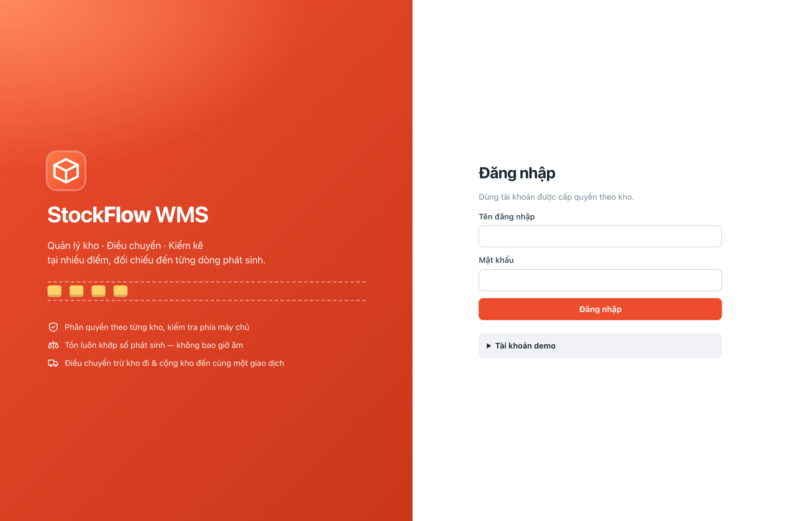
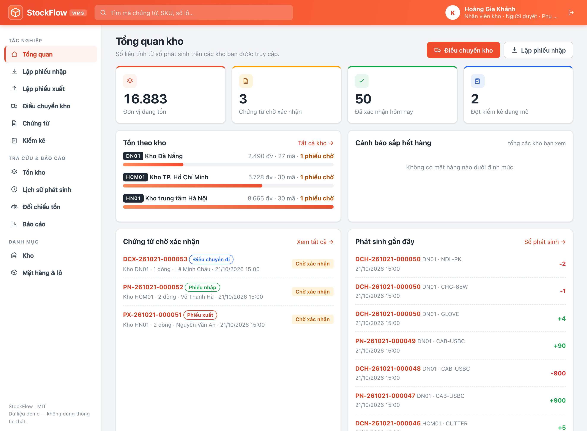
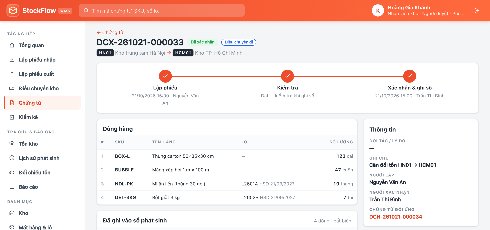
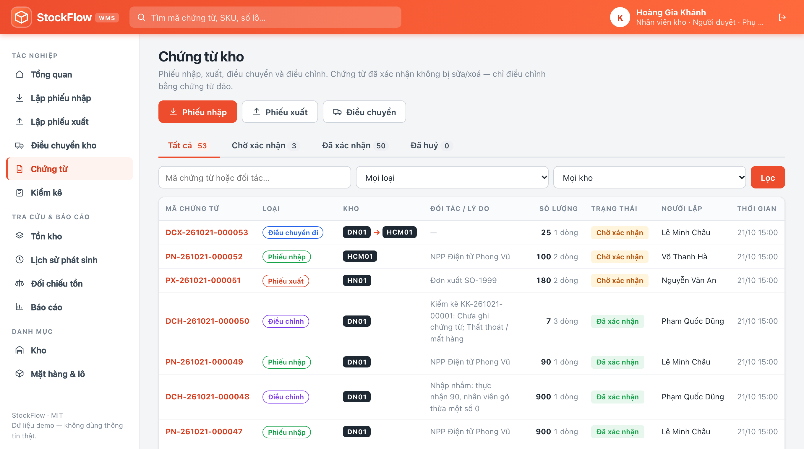
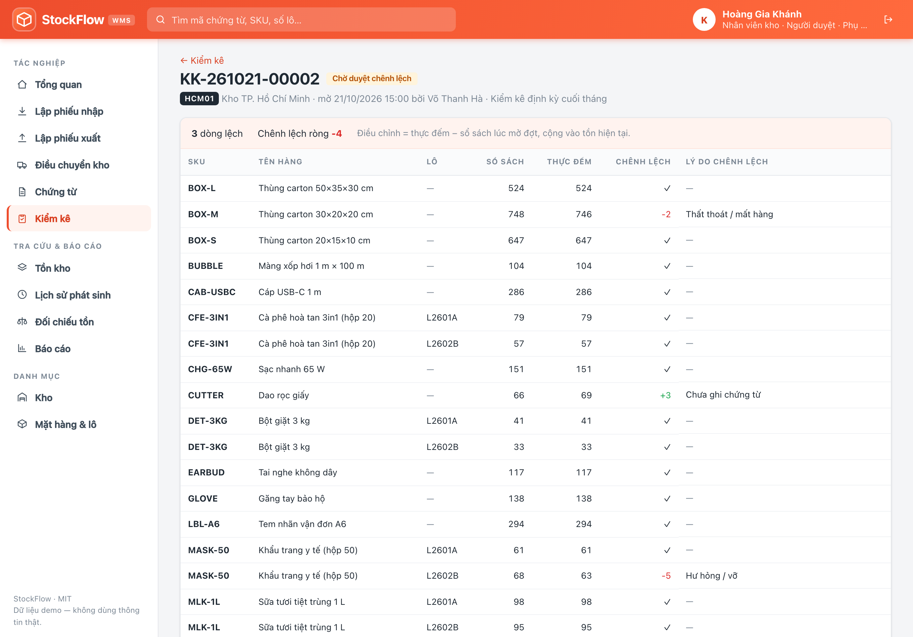
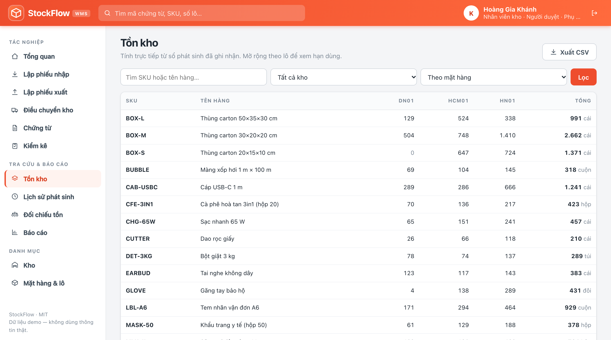
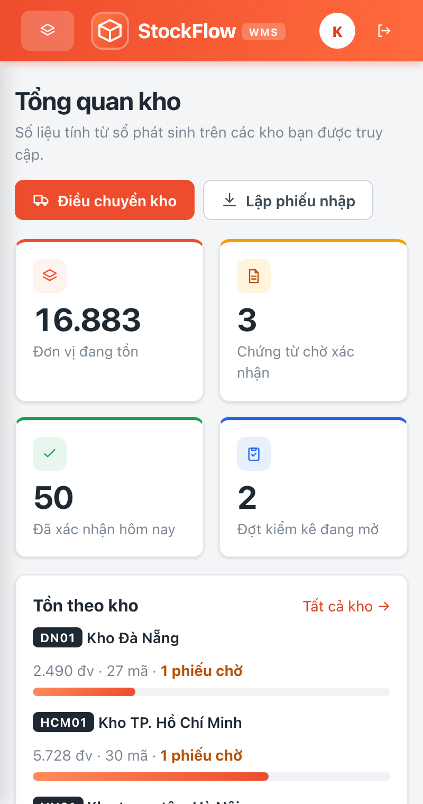
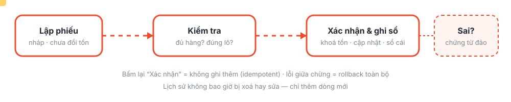
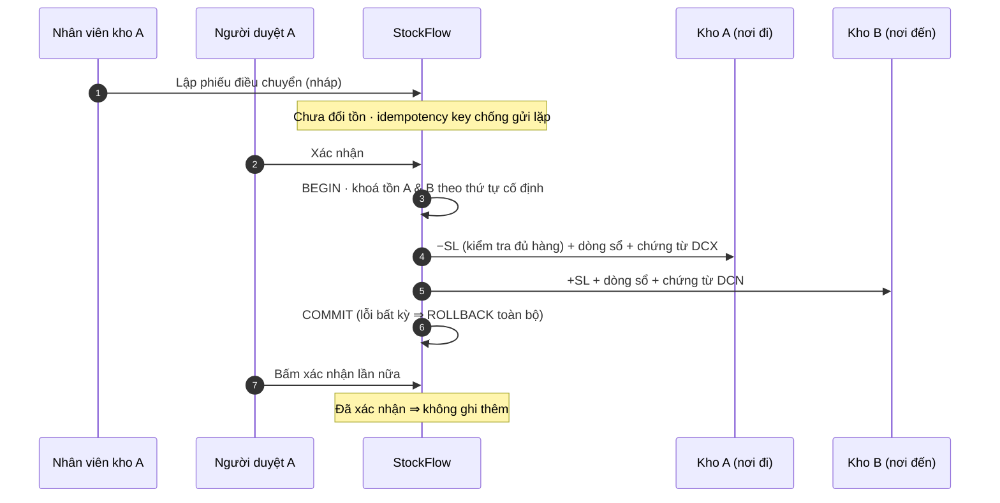
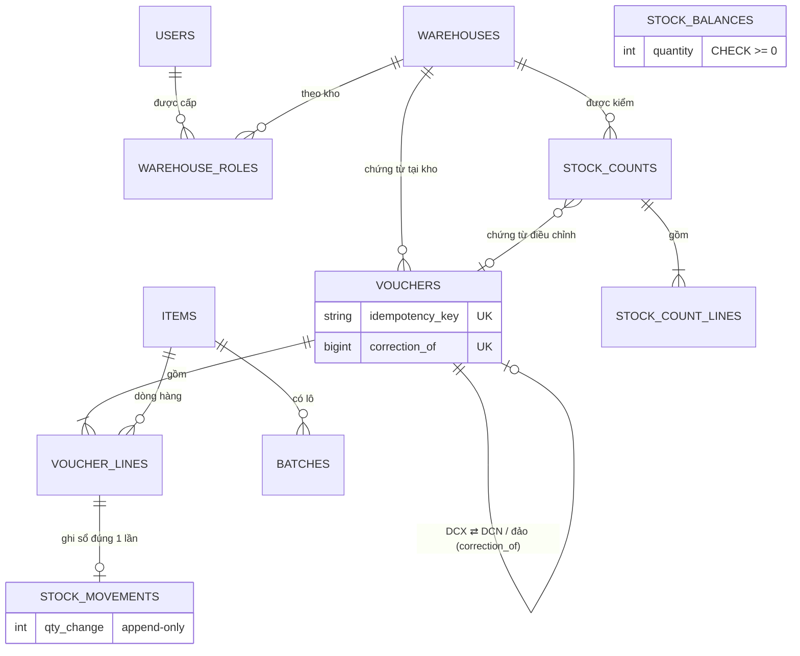

<div align="center">


<a href="https://github.com/buivanchuong9/PTPMMNM-CNTT-1811-NHOM-1">
  
</a>

<br>

[](https://www.php.net/)
[](https://www.mysql.com/)
[](#-kiến-trúc)
[](#-kiểm-thử)
[](LICENSE)
[](https://github.com/buivanchuong9/PTPMMNM-CNTT-1811-NHOM-1/stargazers)

**Hệ thống quản lý kho, điều chuyển hàng và kiểm kê tại nhiều điểm.**
Thuần PHP + MySQL · không framework · phân quyền theo từng kho · cài trong 2 phút.

[Giao diện](#-giao-diện) · [Tính năng](#-tính-năng) · [Chạy thử](#-chạy-thử-trong-2-phút) · [Kiến trúc](#-kiến-trúc) · [Kiểm thử](#-kiểm-thử)

</div>

---

## 📸 Giao diện

Thiết kế theo phong cách cổng vận hành của các đơn vị logistics (cam–đỏ, bảng dày, thẻ trạng thái, timeline theo dõi vận đơn) — dễ quét mắt cho nhân viên kho làm việc cả ngày.

<table>
<tr>
<td width="50%"><br><sub><b>Đăng nhập</b> — băng chuyền thùng hàng chạy, tài khoản demo có sẵn</sub></td>
<td width="50%"><br><sub><b>Tổng quan</b> — KPI đếm động, tồn theo kho, chứng từ chờ duyệt</sub></td>
</tr>
<tr>
<td width="50%"><br><sub><b>Chứng từ</b> — timeline như theo dõi vận đơn, dòng sổ bất biến, chứng từ đối ứng hai kho</sub></td>
<td width="50%"><br><sub><b>Danh sách chứng từ</b> — tab trạng thái có bộ đếm, thẻ loại/trạng thái, tuyến kho</sub></td>
</tr>
<tr>
<td width="50%"><br><sub><b>Kiểm kê</b> — chênh lệch tính ngay khi gõ, bắt buộc có lý do</sub></td>
<td width="50%"><br><sub><b>Tồn kho</b> — ma trận mặt hàng × kho, tính từ sổ phát sinh</sub></td>
</tr>
</table>

<div align="center"><br><sub>Dùng được trên điện thoại · tôn trọng <code>prefers-reduced-motion</code></sub></div>

## ✨ Tính năng

| | Tính năng | Điểm đáng chú ý |
|---|---|---|
| 🏬 | **Danh mục & phân quyền theo kho** | Kho · mặt hàng · đơn vị tính · **lô & hạn dùng**. Vai trò theo từng kho: *Nhân viên kho* (lập phiếu), *Người duyệt* (xác nhận/điều chỉnh), *Phụ trách kiểm kê* |
| 📥📤 | **Phiếu nhập / xuất** | Lập nháp → **kiểm tra** (đủ hàng? đúng lô?) → **xác nhận & ghi sổ**. Nháp không đổi tồn |
| 🚚 | **Điều chuyển hai kho** | Trừ kho đi + cộng kho đến **trong cùng một giao dịch**, tự lập chứng từ ở **cả hai nơi** (DCX/DCN) liên kết nhau |
| 📋 | **Kiểm kê** | Chụp tồn sổ sách → nhập số thực tế → chênh lệch + **lý do** → người duyệt xác nhận → **chứng từ điều chỉnh** |
| 📖 | **Sổ phát sinh bất biến** | Mọi thay đổi tồn là một dòng append-only gắn chứng từ; tồn được **tính từ sổ** |
| ↩️ | **Sửa bằng chứng từ điều chỉnh** | Không sửa/xoá lịch sử — đảo bằng chứng từ mới có lý do (điều chuyển thì đảo cả hai kho trong một giao dịch) |
| ⚖️ | **Đối chiếu & báo cáo** | Trang đối chiếu số dư ↔ sổ ↔ chứng từ; xuất CSV (chống CSV-injection, mở được bằng Excel) |

<div align="center"></div>



## 🚀 Chạy thử trong 2 phút

**Yêu cầu:** PHP ≥ 8.1 (có `mysqli`) và MySQL ≥ 8.0.16 (CHECK constraint chỉ có hiệu lực từ bản này; MariaDB chưa hỗ trợ).

```bash
git clone https://github.com/buivanchuong9/PTPMMNM-CNTT-1811-NHOM-1.git stockflow
cd stockflow

# 1) Tạo CSDL + tài khoản riêng (một lần, với quyền root trong mysql):
#    CREATE DATABASE stockflow CHARACTER SET utf8mb4;
#    CREATE USER 'stockflow'@'localhost' IDENTIFIED BY 'đổi-mật-khẩu';
#    GRANT ALL ON stockflow.* TO 'stockflow'@'localhost';

bin/stockflow db-config    # nhập host/cổng/CSDL/tài khoản/mật khẩu → .local/db.json (chmod 600, đã .gitignore)
bin/stockflow setup        # tạo bảng + nạp dữ liệu mẫu
bin/stockflow serve        # → http://127.0.0.1:8080
```

Không muốn tạo file cấu hình? Dùng biến môi trường `DB_HOST DB_PORT DB_NAME DB_USER DB_PASS` (ưu tiên hơn `.local/db.json`).

**Dữ liệu mẫu:** 3 kho (HN01 · DN01 · HCM01), 30 mặt hàng (10 mặt hàng có lô/hạn dùng), **235 dòng sổ phát sinh**, 7 phiếu điều chuyển đã xác nhận (mỗi phiếu 2 chứng từ) + 1 nháp, một chứng từ nhập nhầm đã được đảo, ba đợt kiểm kê (đã chốt / chờ duyệt / đang đếm).

| Tài khoản (mật khẩu chung `demo1234`) | Quyền |
|---|---|
| `hn.keeper` · `dn.keeper` · `hcm.keeper` | Lập phiếu + kiểm kê tại kho của mình |
| `hn.approver` · `dn.approver` · `hcm.approver` | Xác nhận / điều chỉnh chứng từ tại kho của mình |
| `giamsat` | Mọi quyền trên cả 3 kho |
| `admin` | Quản trị danh mục, tài khoản, phân quyền |

> Thử ngay: đăng nhập `hn.keeper` → thử mở chứng từ của kho DN01 ⇒ **403**. Đó là kiểm tra quyền phía máy chủ, không chỉ ẩn nút.

| Lệnh | Tác dụng |
|---|---|
| `bin/stockflow check` | Kiểm tra kết nối & phiên bản MySQL |
| `bin/stockflow migrate` | Tạo/cập nhật bảng (chạy lại an toàn) |
| `bin/stockflow seed [--force]` | Nạp dữ liệu mẫu (bỏ qua nếu đã có dữ liệu) |
| `bin/stockflow serve` | Chạy web (`PORT=9000 bin/stockflow serve` để đổi cổng) |
| `bin/stockflow test` | Chạy toàn bộ kiểm thử trên CSDL riêng `<tên>_test` |

> ⚠️ Máy chủ built-in của PHP chỉ dành cho phát triển/demo. Mật khẩu demo là công khai — đổi hết trước khi dùng thật.

## 🧱 Kiến trúc

```
.
├── public/                  # document root: index.php (front controller) + assets/ (CSS, JS thuần)
├── src/
│   ├── Core/                # Router, Request/Response, Session+CSRF, View, Container (DI), Db (giao dịch + retry deadlock)
│   ├── Domain/              # StockRules (quy tắc thuần), enum Role/VoucherType, lỗi nghiệp vụ
│   ├── Service/             # Ledger (lõi ghi sổ), VoucherService, TransferService, StockCountService,
│   │                        # StockQuery (tồn/lịch sử/đối chiếu), Authorizer (quyền theo kho), CatalogService
│   └── Http/Controller/     # lớp mỏng: đọc request → gọi service → render
├── templates/               # giao diện PHP theo từng màn hình
├── database/
│   ├── migrations/          # 001 schema · 002 trigger bất biến (tuỳ chọn)
│   └── seeds/DemoSeed.php   # dữ liệu mẫu, tạo bằng chính các service
├── tests/                   # Unit · Integration · Http (+ Support: fixture, chạy song song nhiều tiến trình)
└── bin/stockflow            # CLI: db-config · migrate · seed · serve · test
```



### Quyết định thiết kế

- **Sổ phát sinh là nguồn sự thật.** `stock_movements` chỉ có INSERT, mỗi dòng ứng với đúng một dòng chứng từ (`UNIQUE voucher_line_id`). Tồn hiển thị = `SUM(qty_change)`; `stock_balances` chỉ để khoá hàng và chặn âm. Trang **Đối chiếu** so hai nguồn với nhau.
- **Không âm, không bán lố khi nhiều người cùng xuất.** Mọi thay đổi tồn chạy trong giao dịch; `Ledger::lock()` khoá các dòng tồn theo thứ tự `(kho, hàng, lô)` cố định (không deadlock kể cả khi hai điều chuyển ngược chiều chạy cùng lúc), `Db::transaction()` tự thử lại khi MySQL báo deadlock. `CHECK (quantity >= 0)` là lưới an toàn cuối cùng.
- **Idempotent ở hai tầng.** Tạo phiếu: khoá `idempotency_key` (UNIQUE) trong form ⇒ F5/bấm đúp không sinh phiếu thứ hai. Xác nhận: khoá dòng chứng từ `FOR UPDATE`, đã `CONFIRMED` thì trả "đã xác nhận" và **không ghi thêm**.
- **Điều chuyển nguyên tử.** Khoá cả hai kho → trừ → tạo chứng từ nơi đến + cộng → chốt, một giao dịch. Có điểm chèn lỗi (`Hooks`) giữa hai bước để test rollback; production không đăng ký hook nào.
- **Sửa = thêm, không xoá.** Chứng từ đã xác nhận bất biến (tuỳ chọn khoá cả ở CSDL bằng trigger). Muốn sửa ⇒ chứng từ điều chỉnh đảo kèm lý do; `UNIQUE correction_of` chặn đảo hai lần; đảo điều chuyển yêu cầu quyền duyệt ở **cả hai** kho (không thể dùng làm cửa hậu rút hàng).
- **Kiểm kê giữ giao dịch phát sinh.** Điều chỉnh = `thực đếm − sổ sách lúc mở đợt`, cộng vào tồn hiện tại — hàng nhập/xuất trong lúc đang đếm không bị ghi đè.
- **Bảo mật.** Quyền kiểm tra trong service (không chỉ ẩn nút) + phạm vi đọc theo kho · prepared statement mọi truy vấn · escape đầu ra · CSRF cho mọi POST · cookie `HttpOnly` + `SameSite` · CSP · giới hạn đăng nhập sai · mật khẩu băm `password_hash` · CSV chống injection · cấu hình CSDL ngoài git.

## 🧪 Kiểm thử

```bash
bin/stockflow test      # ~263 test; tự dựng lại CSDL <tên>_test (không đụng dữ liệu thật)
```

| Phép thử bắt buộc của đề | Test |
|---|---|
| Kho còn 5, hai yêu cầu cùng xuất 4 ⇒ chỉ một phiếu ghi nhận, tồn không âm | `Integration/ConcurrentIssueTest` — 2 **tiến trình thật**, 2 kết nối, ép chồng thời gian |
| Lỗi giữa lúc trừ kho A và cộng kho B ⇒ không thay đổi dở dang | `Integration/TransferAtomicityTest` — chèn lỗi giữa hai bước và ở bước cuối |
| Gửi lại chứng từ đã xác nhận ⇒ tồn & sổ không tăng | `Integration/IdempotencyTest` + `Http/AuthorizationHttpTest` |
| Tài khoản chỉ kho A không lập phiếu xuất kho B bằng yêu cầu trực tiếp | `Integration/AuthorizationTest` (service) + `Http/AuthorizationHttpTest` (POST thật qua HTTP) |
| Điều chỉnh kiểm kê có lý do & chứng từ; tổng tồn khớp lịch sử | `Integration/StockCountTest`, `Integration/ScenarioTest` |

Test chạy song song được kiểm chứng là **thật sự phát hiện lỗi**: bỏ khoá `FOR UPDATE` trong `Ledger` ⇒ `ConcurrentIssueTest` đỏ (tồn ra −3); sửa lại ⇒ xanh. `Http/PagesSmokeTest` giữ cho mọi trang chính luôn trả 200.

## 🗺️ Còn lại / ý tưởng

- [ ] Tài liệu phát hành: `CONTRIBUTING`, `SECURITY`, `CHANGELOG`, issue/PR template, CI GitHub Actions
- [ ] Docker Compose chạy một lệnh (đã có `Dockerfile`/`docker-compose.yml` nháp, chưa được kiểm chứng)
- [ ] Mã vạch/QR khi kiểm kê bằng điện thoại · REST API · cảnh báo tồn dưới định mức

## 📚 Nguồn gốc

Phát triển từ chuỗi bài thực hành PHP + MySQL (5 lab) của học phần *Phát triển phần mềm mã nguồn mở*, nhóm PTPMMNM-CNTT-1811-NHOM-1 — nâng cấp từ ứng dụng đăng ký sự kiện thành hệ thống quản lý kho đa điểm.

## ⭐ Ủng hộ dự án

Nếu StockFlow hữu ích hoặc giúp bạn học được điều gì, hãy tặng một ⭐ — đó là động lực lớn nhất để dự án tiếp tục phát triển!

[](https://star-history.com/#buivanchuong9/PTPMMNM-CNTT-1811-NHOM-1&Date)

<div align="center"><sub>Giấy phép <a href="LICENSE">MIT</a> · Làm với ☕ và rất nhiều thùng hàng 📦</sub></div>
