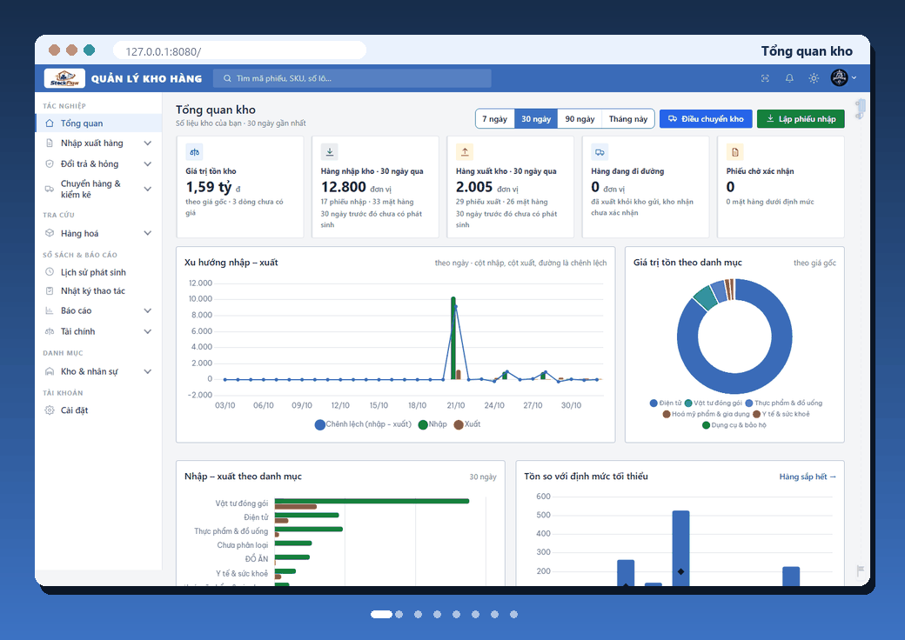

<div align="center">



[](https://www.php.net/)
[](#chạy-thử)
[](https://github.com/buivanchuong9/PTPMMNM-CNTT-1811-NHOM-2/actions/workflows/test.yml)
[](LICENSE)




</div>

# StockFlow — Quản lý kho

Hệ thống quản lý nhiều kho viết bằng **PHP thuần + MySQL**, không dùng framework. Đề tài môn *Phát triển phần mềm mã nguồn mở*, lớp CNTT 1811, nhóm 2.

## Chức năng chính

- **Nhập / xuất kho:** lập phiếu nháp → quản lý kho xác nhận. Hàng theo lô tự xuất lô hết hạn trước (FEFO), không xuất lô đã hết hạn. Xuất bán có thể kèm giao hàng.
- **Điều chuyển giữa các kho:** chọn xe và tài xế hợp lệ (tải trọng, đăng kiểm, bằng lái). Kho đi xuất, kho đến nhận theo số thực nhận; có thu hồi chuyến và báo mất hàng.
- **Đặt hàng nhà cung cấp:** đơn tự cập nhật khi nhận hàng. Lúc nhận có kiểm chất lượng, phần không đạt tự lập phiếu trả nhà cung cấp.
- **Đổi trả, bảo hành, huỷ hàng:** khách trả hàng, tiếp nhận bảo hành theo mã lô / mã món, đề xuất và duyệt huỷ hàng hỏng.
- **Kiểm kê:** đếm → nộp kèm lý do lệch → duyệt, tự lập phiếu điều chỉnh. Có đối chiếu tồn kho với sổ.
- **Hàng hoá:** mặt hàng, lô, hạn dùng, định mức tồn tối thiểu, giá gốc và giá bán riêng từng kho. Quét mã vạch bằng camera, in tem, nhập danh mục và tồn đầu kỳ từ CSV.
- **Báo cáo:** tổng quan và việc cần làm, chuông cảnh báo sắp hết hàng / sắp hết hạn, Nhập–Xuất–Tồn, thẻ kho, giá trị tồn, chi phí nhập, doanh thu. Xuất CSV.
- **Phân quyền:** 3 vai trò (quản trị, quản lý kho, nhân viên), bật tắt từng quyền; quản lý và nhân viên chỉ thao tác trong kho của mình. Mọi thao tác được ghi nhật ký.

Tồn kho được tính từ sổ phát sinh chỉ ghi thêm. Phiếu đã ghi sổ không sửa được: muốn sửa sai thì lập phiếu đảo.

## Chạy thử

Cần PHP 8.1+ và MySQL (XAMPP là đủ, nhớ bấm Start ở MySQL).

```bash
git clone https://github.com/buivanchuong9/PTPMMNM-CNTT-1811-NHOM-2.git
cd PTPMMNM-CNTT-1811-NHOM-2
php bin/stockflow update    # tạo database và dữ liệu mẫu
php bin/stockflow serve     # mở http://127.0.0.1:8080
```

Đăng nhập bằng `admin`, `hn.quanly` hoặc `hn.nv1`. Mật khẩu: `demo1234`.

Chạy kiểm thử: `php bin/stockflow test`

<div align="center">


</div>
